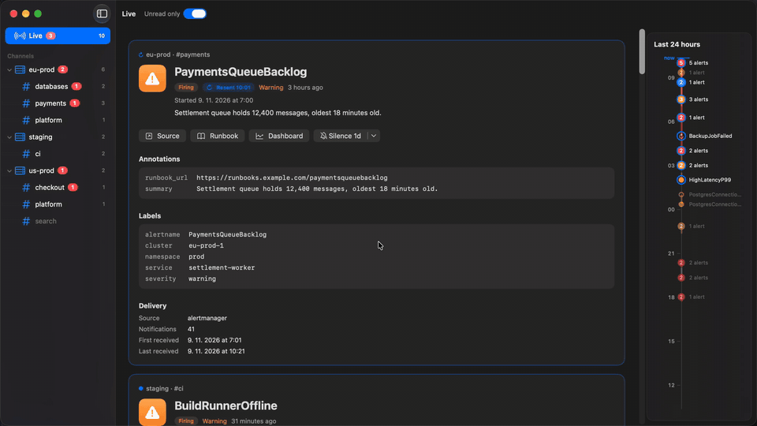

# Achtung

A self-hosted alert inbox with a native macOS client.



A 30-second tour of the client in demo mode, with made-up alerts (`make demo`).
[Full-quality video (MP4)](docs/media/achtung-demo.mp4).

> **Status:** early development. The server ingests Alertmanager webhooks into Postgres
> and serves a read-only client API ([`api/openapi.yaml`](api/openapi.yaml)). Live
> updates (SSE), acknowledgement and the macOS client's API connection are next. Open
> questions are listed at the end.

## The problem

I run, maintain and support a number of systems across several apps and environments.
Their Prometheus alerts are currently sent by Alertmanager to MS Teams channels. That
setup is bad to use and bad to run:

- **UI/UX.** The cards look bad, they are hard to scan, and you can't tell what is new.
  Firing and resolved alerts look almost the same. The client is slow.
- **Delivery.** Teams throttles incoming webhooks, so notifications arrive late or not
  at all, often during the busiest incidents.
- **Configuration.** Setting up connectors and workflows is fiddly and fragile.
- **Model mismatch.** Teams is a chat tool. An alert is not a chat message. It has a
  lifecycle (firing → resolved), an identity and labels, and it needs to be acknowledged.

## What Achtung is

Achtung replaces the "alerts in a chat channel" setup with a tool built for alerts:

- A **server** that receives alert notifications from monitoring systems by webhook,
  normalizes them, stores them and tracks their state. It serves an API to clients.
- A **native macOS client** for viewing alerts and working with them. UI and UX are the
  top priority.

It started as a tool for my own needs and is open source from the start. Anyone can run
their own instance.

## Features

- **One alert, with its history.** Achtung recognizes the same alert every time it fires
  (for Alertmanager, the same label set in the same channel). A repeat notification
  updates the alert instead of adding a message. An alert that keeps firing resurfaces as
  **resent**, at most once an hour, marked differently from a new one
  ([ADR 0009](docs/adr/0009-resends-resurface-alerts.md)). A new firing becomes a new
  **occurrence** of the same alert, and each occurrence lists the alert's other
  occurrences (newest first, up to 20) with their status and start time. Planned features such as flapping detection and per-alert
  notes build on this
  ([ADR 0007](docs/adr/0007-alert-identity-and-history.md)).
- **Channels grouped by where they come from.** Each Alertmanager is an instance (for
  example one Kubernetes cluster), and its channels sit under it in the client's sidebar.
- **What's new since you last looked**, per occurrence and per channel, kept on your Mac.
  Each channel and Live list only new alerts and resends, until you switch
  "Unread only" off there, and "Mark All as Read" (⇧⌘K) clears a list in one go.
- **Home:** each Alertmanager as a tile, counted by the Alertmanager itself: open alerts
  by severity, silenced and inhibited ones, its Watchdog, whether Grafana IRM receives its
  heartbeat, and alerts that never reached Achtung or never resolved in it. Click a tile
  for its alerts by severity. Below, silences ending soon and the noisiest and longest
  firing alerts. Alert names you ignore in Settings (Watchdog, say) stay out of Home's
  counts and lists, for everyone; channels and Live still show them.
- **Live view:** every channel's alerts in one stream, newest change first.
- **Notifications** for new and resent critical alerts (warning too, if you like), with
  Mark as Read and Silence right on them. Achtung keeps watching from the menu bar after
  you close its window ([ADR 0013](docs/adr/0013-macos-notifications-and-background-polling.md)).
- **Home view** (server API, `GET /api/home`): each Alertmanager at a glance, what it has
  open by severity, silenced and inhibited, read from the Alertmanager itself, and whether
  its Watchdog fires. It also flags delivery problems: alerts Alertmanager should have
  sent Achtung but didn't, and alerts still firing in Achtung that Alertmanager has
  dropped (a missed resolve). It only reports them. Plus the active silences, the
  noisiest alerts of the last day and the longest firing ones
  ([ADR 0010](docs/adr/0010-home-view.md)).
- **IRM heartbeat on Home** (server API, `irm` on each `/api/home` tile): whether Grafana
  IRM actually receives the heartbeat the Alertmanager sends it, read from IRM's
  `OnCallHeartBeatMissing` alert groups at most once a minute, with the last missed
  heartbeat. Needs `IRM_API_URL`, `IRM_API_TOKEN` and the instance's `irmIntegrationId`
  ([ADR 0012](docs/adr/0012-irm-heartbeat.md)).
- **Ignored alert names** (server API, `/api/settings/ignored-alerts`): alerts that fire
  forever by design, such as `Watchdog`, `InfoInhibitor` and `grafana-irm-heartbeat` (the
  defaults), are left out of Home's counts, tile lists and delivery check. One list,
  shared by every client and editable by anyone who can reach the API; the inbox still
  shows these alerts, and the Watchdog heart still watches `Watchdog`
  ([ADR 0011](docs/adr/0011-ignored-alert-names.md)).
- **Zero setup per channel:** pointing a receiver at a new URL creates the channel.
- **Readable alerts:** the summary and description as prose, links as buttons, and every
  annotation and label on its own row, a hover away from copying. **Copy for Agent**
  (⇧⌘C) puts the whole alert on the clipboard as Markdown, to hand to an agent
  investigating it.
- **Silence an alert** for a while, on the Alertmanager it came from. Every alert shows
  whether it is silenced and until when, including silences made in Alertmanager itself
  ([ADR 0008](docs/adr/0008-silences-through-the-server.md)). A silence mutes the alert
  for every receiver of that Alertmanager, not only in Achtung.

## Core use case

1. Alertmanager fires an alert and POSTs it to an Achtung webhook. Each channel gets its
   own webhook.
2. The server stores the alert under the right channel. If it already knows the alert
   (same fingerprint), it updates it instead of creating a duplicate.
3. The macOS client shows the new alert right away, with an unread marker and,
   optionally, a system notification.
4. I open the app and see straight away **what is new since I last looked**, what is
   **still firing**, and what has **resolved**.
5. I acknowledge the alert, follow its links (Prometheus expression, runbook, dashboard)
   and move on. When the alert resolves, it updates in place and does not appear as a
   new message.

## Concepts

| Concept | Meaning |
|---|---|
| **Source** | A system that sends alerts. Alertmanager is the first one, and the design must allow others (Grafana, Uptime Kuma, GitHub, cron/backup jobs, custom scripts…). Each source has an adapter that converts its payload to the internal model. |
| **Channel** | A named stream of alerts, usually one per app or environment (`crm-prod`, `legal-machine-dev`, …). Each channel has its own webhook endpoint. |
| **Alert** | The normalized internal record. It has a stable identity (for Alertmanager, the `fingerprint`), a status (`firing` / `resolved`), severity, labels, annotations, timestamps and links back to the source. |
| **Occurrence** | One firing of an alert, from when it starts until it resolves. An alert that fires again gets a new occurrence, and together they are its history. |
| **Event** | Something that happened to an alert: it started firing, it resolved, it fired again, or it was resent while still firing (at most hourly; acknowledgement is planned). Events make up an occurrence's history. |
| **Read state** | What this client has already seen, per channel. It is stored locally in the macOS app and powers "new since last time". |

## Server

- TypeScript on Node.js, Fastify, PostgreSQL (see [ADR 0001](docs/adr/0001-tech-stack.md)).
- **Ingest:** one HTTP endpoint per source type, scoped to a channel, for example
  `POST /ingest/alertmanager/{instance}/{channel}`, where the instance is the sending
  system (e.g. one cluster). Ingest must be fast and
  idempotent, because Alertmanager retries and sends the same alert again every
  `repeat_interval`.
- **Source adapters:** each source is a module that validates its payload and maps it to
  the internal model. Adding a source should not require changes to the core.
- **Storage:** alerts, events, channels and read state.
- **Client API:** list and filter alerts per channel, alert detail and history,
  acknowledge. Server-Sent Events deliver new alerts and state changes to clients without
  polling.
- **Deployment:** a single container on Kubernetes, exposed through an ingress, with an
  external Postgres.

### Security model

Achtung has **no authentication and no users** (see
[ADR 0002](docs/adr/0002-no-authentication.md)). Everyone who can reach an instance sees
all alerts and can acknowledge them, and anyone who can reach the ingest endpoints can
post alerts. **Do not expose it to the internet unprotected.** Restrict the ingress to
your network or VPN, or put an authenticating proxy (oauth2-proxy, basic auth) in front
of it.

### Alertmanager specifics

Alertmanager's webhook sends a group notification (payload version `4`): `status`,
`groupKey`, `groupLabels`, `commonLabels`, `commonAnnotations`, `externalURL`, and an
array of `alerts`. Each alert has `status`, `labels`, `annotations`, `startsAt`,
`endsAt`, `generatorURL` and `fingerprint`. Achtung tracks individual alerts by
`fingerprint` and can still show the group context. See the
[Alertmanager webhook docs](https://prometheus.io/docs/alerting/latest/configuration/#webhook_config).

## macOS client

- Native, built with Swift and SwiftUI.
- **UX goals**, in priority order:
  1. **New since last visit is unmistakable.** Unread counts per channel and a clear
     marker on new items.
  2. **State is obvious at a glance.** Firing and resolved look clearly different, and
     severity is shown by color and position, not only by text.
  3. **Fast and keyboard-friendly.** It opens instantly, you can move through the list
     and acknowledge alerts with the keyboard, and search is quick.
  4. **Calm.** Repeat notifications for an alert that is already firing don't create
     noise: at most an hourly reminder that it still fires. A resolution updates the
     existing item.
  5. **Good defaults over configurability.** The first goal is one very good default
     view. Customization comes later, if it's needed at all.
- A menu bar presence with an unread or firing badge, and optional macOS notifications.
- Layout: channels in a sidebar, then the alert list, then alert details (a standard
  three-column macOS layout).
- **Demo mode:** `make demo` starts the client against a fake server with made-up alerts
  (`macos/scripts/demo-server.py`), to try it or record it without a server or real
  data. A new critical alert fires 45 seconds in. Quitting the app ends the demo.

## Non-goals (for now)

- Replacing Alertmanager's routing, grouping, inhibition or silencing. Alertmanager stays
  the brain, and Achtung is the inbox. Achtung can create a silence on it for one alert
  ([ADR 0008](docs/adr/0008-silences-through-the-server.md)), but managing silences stays
  in Alertmanager.
- On-call scheduling, escalation and paging (PagerDuty/Grafana OnCall territory).
- iOS, web or Windows clients. The API should not prevent them, but they are not planned.
- Multi-tenant SaaS, user accounts and login.

## Open questions

- **Notifications when the app is closed:** APNs push needs an Apple Developer account and
  a relay. Without APNs, system notifications only arrive while the client is running.
- **Retention:** how long resolved alerts and their history are kept, and whether to keep
  raw payloads for debugging (not stored for now, because repeat notifications would
  make them grow without bound).

## Development

Requirements: Node.js and pnpm (versions in `.tool-versions` and `package.json`), Docker
for the tests (they run against a real Postgres), and a Mac for the client.

```bash
pnpm install                  # dependencies and git hooks
pnpm --dir server run check   # all quality checks and tests
DATABASE_URL=postgres://… pnpm --dir server run dev   # run the server on :8080
```

The project is developed mostly by coding agents. Their rules are in
[`AGENTS.md`](AGENTS.md) (`CLAUDE.md` is a symlink to it). Code quality is enforced by
tooling rather than by convention. [ADR 0003](docs/adr/0003-quality-enforcement.md)
explains how, [`docs/architecture.md`](docs/architecture.md) describes the structure,
and [`docs/golden-principles.md`](docs/golden-principles.md) covers the judgement calls.
